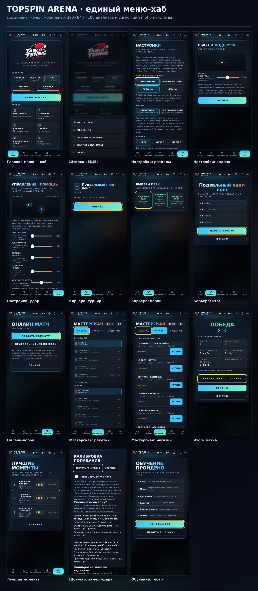

# Единый меню-хаб TOPSPIN ARENA

Меню перестало быть россыпью карточек: это одна оболочка с общим языком движения.
Документ описывает, что получилось, как это устроено и как всё пересобрать.



> Коллаж: `docs/menu-collage.png` (мобильный 390×844, 15 экранов).
> Исходные снимки — `docs/menu-shots/`, десктопные — `docs/menu-shots/desktop/`.

---

## 1. Архитектура оболочки

```
#hub (z-index 40)                  ← оболочка, живёт поверх 3D-сцены
├── .hub-top   #hubTop             ← бренд, кошелёк (монеты/кристаллы), звук, полный экран
├── .hub-stage #hubStage           ← сцена: все прежние .screen, но теперь внутри хаба
├── .hub-dock  #hubDock            ← док: ИГРА · КАРЬЕРА · МАСТЕРСКАЯ · ОНЛАЙН · ЕЩЁ
│                                  ← + #dockPill (морфинг-пилюля на пружине)
├── .hub-scrim #hubScrim           ← затемнение под шторкой
├── .hub-drawer #hubDrawer         ← шторка «ЕЩЁ»: настройки, обучение, моменты, зона, демо
├── .hub-fx    #hubFx              ← слой частиц (искры, монетки)
├── .hub-live  #hubLive            ← aria-live: объявления для скринридера
└── .hub-toast #hubToast           ← тосты внутри хаба
```

Источник истины — класс `.on` у экрана. `MenuHub` следит за ним через
`MutationObserver` (только по `.screen`, чтобы не реагировать на игровые классы)
и синхронизирует оболочку: виден ли хаб, какой док активен, где пилюля.

Правило «один экран за раз» стало обязательным: `UI.showScreen(id)` закрывает все
остальные экраны. Раньше настройки открывались поверх главного меню, и меню
читалось как слоёный пирог.

### Переходы между экранами

Один язык: сдвиг 12 px + масштаб 0.99 → 1 + прозрачность, 0.24–0.30 с.
Внутри экрана — каскад: карточка едет целиком, а её содержимое только проявляется.

> Почему карточка едет целиком: когда каждый блок внутри карточки двигался сам по
> себе, `touchstart` и `touchend` приходили на разные элементы, и Chromium не
> генерировал `click` — тап по кнопке камеры не срабатывал на телефоне.
> Это нашлось только в реальном мобильном прогоне.

## 2. Motion-система (`tt/src/82_hub.js`)

| приём | где | как |
|---|---|---|
| Пружина | `HubSpring` | критическое демпфирование, без пролёта и «резинового» хвоста |
| Морфинг пилюли дока | `movePill` | две пружины: по X и по ширине |
| Каскад | `.hub-enter` | индексы задержек проставляются один раз (`prepareStagger`) |
| Смена экрана | `.screen` | общий переход для всех разделов |
| Блик по кромке | `.btn-hero` | тонкий луч вместо размытой засветки |
| Дешифратор | `hubScrambleFrame` | заголовок собирается из шума, 420 мс |
| Счётчик чисел | `setNumber` | монеты/кристаллы/опыт едут к новому значению |
| Конфетти | `burst` | искры победы из счёта, 0.9–1.2 с, снимаются с DOM |
| Монетный дождь | `coinFly` | монетки летят в счётчик кошелька |
| Тост | `toast` | короткий, живёт в оболочке, не перекрывает док |
| Рипл | `bindRipples` | круг от реальной точки касания |
| Прожектор | `bindSpotlight` | свет следует за пальцем и гаснет, когда палец ушёл |

Один `requestAnimationFrame` на весь хаб (`HubTicker`), спит, когда никто не двигается.
`prefers-reduced-motion` выключает декоративное, но не логику: экраны, счётчики,
счёт и статусы остаются.

### Правила, которые стоит не ломать

1. `transition: all` на кнопке анимирует наследуемую `visibility` — кнопка остаётся
   `hidden` первые ~80 мс и тап не доходит. Только явные списки свойств.
2. Тяжёлые фоны (аврора, лучи, стекло) не анимируются, когда хаб закрыт:
   `#hub:not(.on) *{animation:none}` — иначе композитор считает их в каждом кадре матча.
3. `filter: blur()` на фоне хаба съедал кадры в 4 раза — блюр убран.
4. Никаких независимых трансформаций у вложенных блоков внутри карточки.

## 3. Клавиатура, фокус, aria

* `Tab` зациклен внутри открытого модального экрана (`trapDialogFocus`).
* `Escape` закрывает верхний экран по цепочке: лаборатория → шторка → раздел хаба →
  главный экран. Во время матча Escape не открывает меню поверх игры.
* Каждый экран — `role="dialog" aria-modal="true"` с русским `aria-label`.
* `#hubLive` (`aria-live="polite"`) объявляет, куда попал игрок.
* Счёт и статусы — в `aria-live`; выбранные пункты — `aria-pressed` / `aria-current`.
* Пилюля дока и `aria-current="page"` показывают текущий раздел.

## 4. Настройки: что можно менять, а что нельзя

Общие допуски игры (`MATCH_RULES`) заморожены: окно захвата, помощь прицела,
помощь в позиции, чувствительность и подсветка зоны — read-only, одинаковы для всех.

Личные множители (`PLAYER_TUNING`) ужимают, но никогда не расширяют:

| параметр | по умолчанию | диапазон |
|---|---|---|
| `capture` (окно захвата) | 100 % | 70–100 % |
| `press` (зона нажатия) | 100 % | 70–100 % |
| `aim` (помощь прицела) | авторское | 50 % – авторское |
| `approach` (подход за мячом) | авторское | 50 % – авторское |
| `sens` (чувствительность) | 1.00× | 0.70–1.30× |

Плюс профиль жеста `hold`: без свайпа вниз — удержание или медленное ведение вверх
даёт подрезку.

## 5. Что сделано по итогам 100 анализов и 100 симуляций

Полный отчёт: [`docs/menu-motion-analysis.ru.md`](menu-motion-analysis.ru.md),
машиночитаемый результат: `docs/menu-motion-analysis.json`,
инструмент: `tt/tools/menu_motion_sim.cjs` (`npm run analyze:menu`).

Коротко: из 28 приёмов каталога выбрано 21, отклонено 7 — с причинами
(доступность, читаемость, трудоёмкость, «одна модель навигации», «нет состояния
загрузки»). Симуляция детерминирована: 100 прогонов × 2 раунда, фиксированный seed.

## 6. Как пересобрать

```bash
npm run build          # сборка офлайн-HTML (tt/build.py)
npm test               # node-тесты, включая tests/menu-hub.test.js
npm run test:browser   # реальный Chromium: десктоп 1280×760 и мобильный 390×844
npm run analyze:menu   # 2 раунда × 100 симуляций → docs/menu-motion-analysis.*
npm run shots:menu     # снимки экранов + коллаж docs/menu-collage.png
node tt/tools/menu_shots.cjs --desktop   # десктопные снимки
```

## 7. Юридические оговорки

Они живут в главном меню (`hub-legal`) и, кроме того, в своих экранах:

* покупки не дают преимущества на столе;
* реклама всегда необязательна и никогда не прерывает матч;
* онлайн-комнаты — экспериментальный режим, relay задаётся через `?net=wss://…`.
