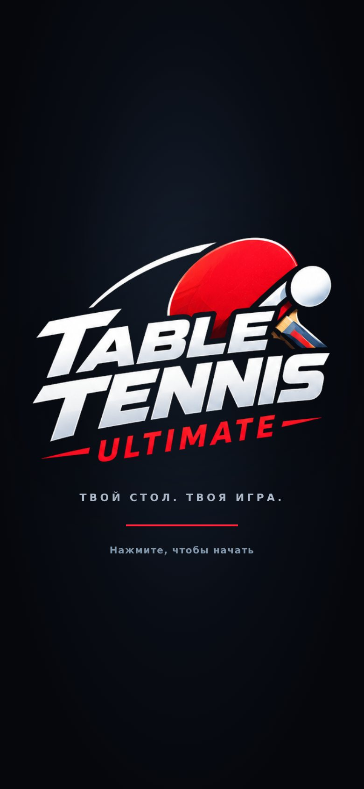

# АУДИТ AAA · TOPSPIN ARENA
### 20 категорий, 30 главных ошибок и оценка «насколько это готовый продукт», а не демо

**Дата:** 2026-10-17 · **Ветка:** `arena/0f3dd276-tabletennis` · **Коммит:** `a260270` («99-level AAA+ improvements»)
**Артефакт:** `play/index.html` = `table-tennis-topspin.html` (1 423 821 байт, 14 746 строк) · **Исходники:** `tt/src/*` — 26 файлов (24 JS + HTML + CSS), 14 675 строк

---

## 0. Три числа

| Что | Балл | Расшифровка |
|---|---:|---|
| **Общий балл продукта** | **50 / 100** | Взвешенно по 20 категориям. Это оценка **опубликованной сборки**, а не замысла |
| **Игровое ядро** (физика, свайп, удары, ИИ, правила, обучение, HUD) | **75 / 100** | Здесь действительно сильная работа: ITTF-отскок 23.6 см, 600 Гц, 16 архетипов, читаемый ИИ |
| **Готовность к выпуску** (взвешенное среднее 13 категорий вне игрового ядра) | **35 / 100** | Продукт в текущем виде **не запускается вообще**; ниже — почему и что именно чинить |

Я смотрел на TOPSPIN ARENA как на продукт, который завтра идёт в глобальный софт-лонч: не «есть ли потенциал», а «что увидят первые 100 000 игроков и где они уйдут». Поэтому балл считается по опубликованному артефакту, а не по замыслу.

**Вердикт одной фразой.** Под оболочкой — по-прежнему один из самых честных свайп-теннисов, которые можно найти в коде; на поверхности — **чёрный экран с логотипом**, потому что в коммите-мердже PR #7 приехали четыре независимые синтаксические/рантайм-блокировки, а тесты и CI этого не увидели. Это не «плохая игра». Это **хорошая игра, которую никто ни разу не запустил целиком**.

> Все визуальные скриншоты ниже сняты на **временной локальной копии** (`/tmp/revive`), где блокировки исправлены, чтобы вообще увидеть интерфейс. В репозиторий патч не вносился. Скриншоты опубликованной сборки — только экран загрузки, дальше она не идёт.

### Если у вас пять минут

1. **50/100.** Ядро — 75, оболочка — 35. Это не средний прототип: физика и свайп действительно сильные.
2. **Игра не запускается.** Три синтаксические ошибки в бандле + `require` в браузере. `npm test` при этом зелёный: он не парсит то, что публикуется.
3. **После починки синтаксиса падает ещё 8 классов ошибок** — `V3.scale`, `M4.setAxisAngle`, `V3.zero()` без `out`, `ai.pos`, эмоции с неверным объектом. Это десятки `TypeError`, а не один баг.
4. **Витрина не работает как витрина.** IAP выдаёт товар бесплатно, «реклама» даёт монеты без рекламы, сезонный пропуск ничего не открывает, косметика не влияет на игру, музыка не звучит.
5. **Телефонный UX ломается в трёх местах:** мастерская (CTA за экраном), пауза (главная кнопка не главная), ландшафт (28 px полосы текста). Это чинится за неделю.
6. **Порядок действий:** 48 часов на P0 и тест бандла, потом спринт на меню/настройки/витрину, только потом арт. Иначе визуальные правки не увидит никто.

---

## 1. Методика и границы

Что реально проверено:

- `npm test` — **41/41 тест зелёный**.
- `npm run test:browser` — **падает по таймауту 30 с**: `window.__game` не появляется.
- `node --check` по каждому `tt/src/*.js` → 2 синтаксические ошибки; `node --check` по извлечённому `<script>` бандла → **3 синтаксические ошибки**.
- Chromium (headless, WebGL на SwiftShader — софтверный растеризатор) + Puppeteer: загрузка, клики, полный розыгрыш, все экраны, 6 viewport'ов (320×568, 360×640, 390×844, 844×390, 768×1024, 1280×800).
- `axe-core` (WCAG 2.1 A/AA) на меню, настройках, мастерской и в игре.
- Замеры: отскок ITTF, стоимость `update`, размеры/скроллы карточек, hit-target'ы, DOM-состояние настроек, вызовы WebAudio.
- Временный патч (только в `/tmp`) — чтобы снять UI и проверить вторую волну падений; исправления перечислены в §3.

Чего **не** было и что нельзя выдумывать:

- Реального iPhone/Android, реального GPU, 120 Гц, тёплого троттлинга. Софтверный GL даёт 0.7–1.6 с на кадр — **это не измерение FPS телефона**, поэтому категория «производительность» оценена по архитектуре и рискам, а не по этим цифрам.
- Двух живых клиентов онлайна, реальных платежей и рекламных SDK.
- Прослушивания звука «ушами»: выводы по графу WebAudio и по тому, что реально стартует.

---

## 2. P0: опубликованная игра не запускается

Откройте `play/index.html` в браузере. Вы увидите ровно это — и больше ничего:



В консоли:

```
SyntaxError: Unexpected token '{'
```

`UI()` и `Game()` не создаются, `window.__game` отсутствует, `boot()` не доходит до `catch`, потому что **ошибка парсинга всего бандла** случается до выполнения любого кода. Экран загрузки остаётся навсегда: у него нет таймаута ошибки, только `setTimeout(dismissSplash, 1600)` внутри `start()`.

### Четыре независимые блокировки

| # | Файл:строка | Что не так | Тип |
|---|---|---|---|
| B1 | `tt/src/70_game.js:69` | `new (require('./85_bioRacket').RacketBiomech …)` — CommonJS `require` внутри браузерного бандла. Даже после починки синтаксиса это `ReferenceError` на конструкторе | рантайм |
| B2 | `tt/src/85_bioRacket.js:455` → `:501` | `function computePlayerBioRacket(game, ctx)` и ниже `const ctx = { … }` — повторное объявление параметра | **SyntaxError** |
| B3 | `tt/src/75_feedback.js:347–351` | Лишняя `}` закрывает класс `HitFeedbackSystem` **перед** методом `setHaptic`; метод остаётся снаружи класса | **SyntaxError** |
| B4 | `tt/src/70_game.js:2727` + `tt/src/10_math.js:8` | `const DEG = Math.PI / 180;` объявлен дважды на верхнем уровне одного бандла | **SyntaxError** |

Почему это особенно обидно: шесть новых модулей «99-level» (`75_feedback`, `75_music`, `76_emotion`, `81_uiAnim`, `85_bioRacket`, `86_meta`) — это **2 561 строка**, и три из них (`75_feedback`, `85_bioRacket`, `76_emotion`) **не выполнялись ни разу**.

### Почему зелёные тесты этого не поймали

1. `tests/build.test.js` (18 строк) сравнивает опубликованный HTML с **тем же самым** свежим билдом из тех же самых сломанных исходников. Совпадение байт — да, работоспособность — нет.
2. `npm test` грузит модули по отдельности в `vm` и никогда не парсит итоговый `<script>`. Дубликат `DEG` и `require` видны только в бандле.
3. `npm run test:browser` — единственный тест, который действительно открывает страницу — **красный**. Но он не в `npm test`, а README утверждает, что тесты запускаются в GitHub Actions; каталога `.github/` в репозитории **нет**.

**Фикс (≈1 час):** убрать `require`, убрать лишнюю `}`, убрать второй `DEG`, переименовать внутренний `ctx`. Затем добавить в `npm test` две дешёвые проверки, которые поймали бы всё это:

```js
// 1) бандл должен парситься
const js = html.match(/<script>([\s\S]*)<\/script>/)[1];
new Function(js);               // SyntaxError здесь = красный тест
// 2) в бандле не должно быть require( / module.exports
assert.ok(!/\brequire\s*\(/.test(js));
```

Плюс `npm run test:browser` в CI на каждый PR. Это не «улучшение» — это минимальная страховка от повторения.

---

## 3. Вторая волна: игра падает сразу после того, как её «починили»

Мы применили четыре фикса выше в `/tmp/revive` (не в репозитории) и получили… новый набор падений. Ниже — то, что обязан увидеть любой, кто запустит игру после P0. Это важно для оценки: **готовность к выпуску — не 50, а 35**, потому что между «синтаксис сошёлся» и «можно играть» лежит ещё восемь классов ошибок.

| # | Файл:строка | Симптом | Причина |
|---|---|---|---|
| B5 | `56_rig.js:205, 357`; `85_bioRacket.js:271, 477`; `70_game.js:1635, 2283, 2289, 2312` | `TypeError: V3.scale is not a function` | В `10_math.js` есть только `V3.mul(out,a,s)`; `scale` не существует. 8 вызовов |
| B6 | `56_rig.js:201`; `70_game.js:1631`; `85_bioRacket.js:256` | `Cannot set properties of undefined (setting 'z')` | `V3.zero()` вызван без `out`-вектора |
| B7 | `56_rig.js:208` | `Cannot read properties of undefined (reading 'x')` | `V3.add(fist, fistOffset)` — нет `out`, второй аргумент уходит в `undefined` |
| B8 | `56_rig.js:428, 430, 444` | то же | `V3.sub(end, start)` без `out` |
| B9 | `56_rig.js:102, 111` | `M4.setAxisAngle is not a function` | В `M4` такого метода нет; используется для пронации/супинации |
| B10 | `70_game.js:2538, 2546, 2548` | `Cannot read properties of undefined (reading 'y')` | `ai.pos` и `ai.faceNormal` не существуют, пока ИИ не построил первый план (`55_ai.js:625` создаёт `pos` только внутри `if (plan)`) |
| B11 | `70_game.js:2402–2412` → `76_emotion.js:208` | `TypeError: g.msg is not a function` **на первом «большом» моменте** (удар > 85, сетка или ребро) | `emotion.update()` получает снимок `{state, rally, …}`, а `EmotionalSystem` вызывает `g.msg`, `g.hitFlash`, читает `g.server`. Нужен сам `Game` |
| B12 | `76_emotion.js:96–101` | `ReferenceError: g is not defined` на матчболе | `_triggerMatchPoint()` объявлен без параметра, но использует `g.server`. Плюс опечатка `'МATCH POINT'` (кириллическая «М») — в UI это видно, если бы дошло |

После этих правок (мы их все сделали локально) игра наконец работает: 90 секунд бот-против-бота, 0 исключений, полный розыгрыш, меню, карьера, мастерская, матч-энд. То есть **потенциал жив**, но текущий коммит — это черновик, в котором каждая новая система написана против несуществующего API.

**Вывод для оценки.** Это не «30 мелких багов». Это отсутствие одного обязательного шага: **smoke-тест полного кадра в реальном браузере на каждый merge**. Один такой тест стоит 30 секунд CI и ловит B1–B12 разом.

---

## 4. Топ-30 ошибок и недоработок

Приоритеты: **P0** — блокирует запуск/игру, **P1** — ломает продукт или доверие, **P2** — заметно снижает качество, **P3** — полировка.
Эффорт: S ≤ 0.5 дня, M ≤ 3 дней, L ≤ 2 недель, XL — больше.

| # | Кат. | P | Ошибка / недоработка | Доказательство | Фикс | Эффорт |
|---|---|---|---|---|---|---|
| 1 | 1 | P0 | **Опубликованная сборка не стартует**: 4 независимые блокировки (B1–B4) | `SyntaxError`, `window.__game === undefined`, скриншот §2 | §2, затем `node --check` бандла в CI | S |
| 2 | 1 | P0 | **Вторая волна падений** после P0: 8 классов ошибок (B5–B12) | `/tmp`-патч → новые `TypeError` в кадре и на розыгрыше очка | выровнять API `V3/M4`, инициализировать `ai.pos/faceNormal`, передать `Game` в эмоции | M |
| 3 | 2 | P0 | **Тесты не видят продукт**: 41/41 зелёные при чёрном экране | `tests/build.test.js` сравнивает байты; `npm test` не парсит бандл | парсить бандл + smoke-загрузку в Chromium + CI | M |
| 4 | 2 | P0 | **Нет CI**, хотя README обещает GitHub Actions | `.github/` отсутствует | workflow: install → build → test → browser | S |
| 5 | 1 | P0 | **Boot не умеет падать красиво**: любой сбой маскируется под «WebGL недоступен», без reload; ошибки после старта не ловятся; при синтаксической ошибке splash висит вечно | `90_boot.js:7–32`; splash-таймаут только в конце `start()` (`:61`) | `window.onerror` + экран ошибки с кодом, reload и «сообщить» | S |
| 6 | 13 | P1 | **Сложность в меню не соответствует игре**: подсвечен «ПРО», реально запускается «НОВИЧОК» (level 0); после перезагрузки подсветка вообще не синхронизируется | DOM: `sel=2`, `pendingDiff=0`, `settings.difficulty=0` → матч `ai.levelIndex=0`; после reload `difficulty=4`, а подсвечен всё ещё «ПРО» | `syncMenuDifficulty()` из `settings.difficulty`, `startMatch()` из выбранного | S |
| 7 | 13 | P1 | **Экран настроек — заглушка**: 31 ключ настроек, 2 ползунка. Нет громкости, качества, левой руки, чувствительности, вибро, телеметрии, счёта матча, авто-сложности, следа/зоны | `02_body.html:160–195`; `80_ui.js:777–830`; `90_boot.js:36–38` биндит несуществующие `[data-set="target"]` | полный settings-экран с секциями и «Advanced» | M |
| 8 | 13 | P1 | **11 «99-level» настроек не сохраняются, 3 не читаются вообще** | whitelist `70_game.js:933–941`: нет `showDebug`, `showPlayerPaddle`, `slowmoOnBigShots`, `showSpinIndicator`, `showZoneIndicators`, `showQualityRing`, `followThrough`, `anticipationHint`, `shotFeedback`, `momentumBar`, `replaySlowmo`; у `showZoneIndicators`/`showQualityRing`/`replaySlowmo` — 0 обращений | либо довести до UI+сейва, либо удалить | S |
| 9 | 14 | P1 | **Мастерская на телефоне: кнопки «Поставить в игру» и «Закрыть» ниже экрана** | 390×844: карточка 1 472 px при окне 774 px, `#wsClose` на y=1460; 320×568 — 1 225 px при 521 px, `#wsClose` на y=1181 | sticky-хедер с табами и закрытием, sticky-футер с CTA | M |
| 10 | 13 | P1 | **Пауза: главное действие — не главное** | «ПРОДОЛЖИТЬ» — нейтральная рамка, а «ПОВТОРЫ ПРОМАХОВ» подсвечена оранжевым (`05_style.css:424`), скриншот 04 | одна primary-кнопка «Продолжить», debug — в «Ещё» | S |
| 11 | 17 | P1 | **IAP выдаёт товар бесплатно**: на вебе `grant()` вызывается без платежа | клик «STARTER €2.99»: coins 250→1750, crystals 0→300, `b_loop` выдан, `purchases=1`, тост «ПОКУПКА ЗАЧТЕНА» | без нативного стора IAP не показывать/не выдавать; витрину прятать по `platform` | S |
| 12 | 17 | P1 | **«Смотреть рекламу» без рекламы**: +120 монет сразу, SDK не вызывается | `86_meta.js:558–583`; замер: клик → +120, `ads.watched=1` | интеграция Poki/CrazyGames rewarded или убрать кнопку | M |
| 13 | 17 | P1 | **Сезонный пропуск продаёт то, чего нет**: обещаны 60 уровней, скины, арены и 400 кристаллов — выдаётся одна строка «ПРОПУСК АКТИВЕН» | `SHOP_BUNDLES.pass:448–449`; `grant():538`; `season.premium` читается только в `80_ui.js:725` | реализовать дорожку/награды или убрать товар | L |
| 14 | 17 | P1 | **Косметика не влияет ни на что**: след, арены, грип продаются, но рендер их не читает | `profile.data.cosmetics` упоминается только в `86_meta.js`; `Scene` всегда `new Scene(R,'arena')` (`70_game.js:63`), 3 палитры не переключаются | прокинуть cosmetics в trail/Scene/grip + превью в магазине | L |
| 15 | 12 | P1 | **«Динамический саундтрек» не звучит**: буферы base/tension (4 с) не проигрываются ни разу, играет только 2-секундный «resolution» на каждое очко; он идёт **мимо master gain**, поэтому mute/volume его не глушат | замер 20 с: 43 старта, все `duration=2`; `75_music.js:351, 383` → `ctx.destination` | подключить слои к `audio.bus`, играть base/tension, не спамить resolution | M |
| 16 | 10 | P1 | **Сцена пустая, соперник — летающая рука**: нет тела, трибун, арен, света-шоу; стол в чёрном зале | скриншоты 02/03/06; `60_scene.js:331–343`; `56_rig` рисует только кисть/предплечье | хотя бы бюст+плечи соперника, 2–3 арены, crowd-плоскости | XL |
| 17 | 19 | P1 | **Бренд и язык разъезжаются**: логотип «TABLE TENNIS ULTIMATE», title/README «TOPSPIN ARENA»; «SLOW/SHIFT» на телефоне; «BASIC 5», «OFFENSIVE 7», «ELO», «MATCH POINT» в русском UI | `tt/build.py:45`; `02_body.html:52–56`; `84_racket.js:54–66`; `76_emotion.js:97–98` | один глоссарий, локализация всех строк, скрыть `SHIFT` на touch | S |
| 18 | 16 | P1 | **В карьере нет личности соперника**: на табло всегда имя уровня ИИ («НОВИЧОК/ПРО»), а не имя/стиль/флаг из сетки | `80_ui.js:872` → `g.ai.L.name`; скриншот 07 — только текст | передавать `career.opponents[i]` в HUD, аватары/флаги | M |
| 19 | 14 | P1 | **На телефоне в ландшафте игра сжата в 28 px полосы текста**, больше половины кадра пустые, подсказки скрыты | 844×390: `#playband.height=28`; скриншот 06 | отдельный landscape-layout: HUD по бокам, камера шире | M |
| 20 | 16 | P1 | **Карьера — список кнопок, а не турнир**: нет сетки, трофеев, награды за этап не показаны; выбор соперника = выбор сложности по ELO | `showCareerIntro` (`80_ui.js:1505–1516`), скриншот 07 | bracket-экран, награда/очки, «путь к финалу» | L |
| 21 | 11 | P2 | **Настройка вибро не управляет ударами**: `hitFeedback.haptic()` проверяет только `_hapticEnabled`, а `setHaptic()` не вызывается нигде | `75_feedback.js:252–253`, `351`; `grep setHaptic` → 0 вызовов | проверять `game.settings.haptics` в `haptic()` | S |
| 22 | 15 | P2 | **Нет стратегии качества**: движок умеет `low/medium/high`, но переключателя нет, всегда «high»; авто-тира по FPS/устройству нет | `20_gl.js:466–522`; `80_ui.js:799` недостижим из UI; `70_game.js:475` | меню качества + авто-тир и динамический DPR | M |
| 23 | 20 | P2 | **Нет PWA/установки**: нет manifest, apple-touch-icon, service worker, офлайн-кэша | поиск по репозиторию — 0 совпадений | manifest + иконки + SW + install-prompt | M |
| 24 | 19 | P2 | **Только русский, без i18n**: 573 строковых литерала с кириллицей, `<html lang="ru">`, EUR-цены захардкожены | `grep` i18n — пусто; `SHOP_BUNDLES` | en/ru словарь, формат валюты по локали | L |
| 25 | 19 | P2 | **Доступность: 1 serious в axe, 18 целей <44 px на десктопе, нет контраста/дальтонизма/размера текста** | axe: `label-content-name-mismatch` на `#slow`; замер: 18 controls <44 px | исправить label, поднять цели, добавить high-contrast/крупный текст | M |
| 26 | 18 | P2 | **Онлайн виден как режим, хотя это релей без симуляции**: гостевые удары не входят в авторитетную физику; код комнаты через `prompt()`; захардкожен `wss://topspin-relay.fly.dev` | `27_network.js:20`; `80_ui.js:1654`; README сам признаёт | спрятать за «Beta», нормальный ввод кода, lockstep или P2P-хост | XL |
| 27 | 8 | P2 | **Обучение можно «пройти», ничего не сделав**: 6 нажатий «ДАЛЬШЕ» → «ОБУЧЕНИЕ ПРОЙДЕНО»; панель не интерактивна вне кнопок; в каждом матче снова «СВАЙП = УДАР» | прогон: 6 skip → `tdone`; `#playband #train{pointer-events:none}` | гейт по критерию шага, «пропустить всё» с подтверждением, не повторять теорию в матче | M |
| 28 | 7 | P2 | **Матч — одна партия**: `this.games` не используется, нет best-of/смены сторон; целевой счёт 5/11/21 недоступен в UI | `70_game.js:169, 507`; `games[` — 0 чтений | best-of-3/5, смена сторон, счёт по партиям | M |
| 29 | 17 | P2 | **Экономика не сходится с ценниками**: старт 250 монет, победа 30, поражение 8, ракетки 600–4200 (30 побед до первой); 5 реклам×120/день; пасс за €4.99 ничего не даёт | `86_meta.js:410–424, 433–451, 31` | симулятор прогрессии, 3–4 сессии до первой покупки, убрать pay-to-skip перекос | M |
| 30 | 20 | P3 | **Документы продают несуществующее**: «GitHub Actions», «99», «20 268 проверок», «63/100→99» — при красном браузерном тесте и отсутствии CI/лицензии/privacy | README, `ПЛАН-99.md`, `АНАЛИЗ-1000.md`; `.github` нет | один «status.md» с проверяемыми числами и датой; LICENSE/privacy | S |

**Ещё 10 идей, не вошедших в топ-30** (в порядке пользы): реплей с ракурса «от соперника»; режим «мишени» как отдельная мини-игра; ежедневный челлендж с фиксированным сидом; тренировка приёма конкретного вращения; экран «разбор матча» вместо 6 цифр; настройка «крупный мяч/контраст»; вибро-паттерны по типу удара; тренер по таймингу (раньше/позже) на паузе; экспорт хайлайта в видео; таблица рекордов клуба (локальная, без сервера).

---

## 5. Двадцать категорий

Вес — вклад в общий балл. Оценка — относительно **лучших мобильных игр**, а не среднего прототипа.

| # | Категория | Вес | Балл | Что показала проверка | Что поднимет до 90 |
|---|---|---:|---:|---|---|
| 1 | Запуск и стабильность сборки | 8% | **5** | Опубликованный файл не создаёт `Game`; 12 точек падения (B1–B12) | P0 + smoke в CI |
| 2 | Инженерное качество, тесты, CI | 4% | **30** | 41/41 зелёные, браузерный тест красный, CI нет, `node --check` не входит в тесты | парсинг бандла, Chromium smoke, workflow |
| 3 | Физика мяча и ракетки | 6% | **85** | ITTF-отскок **23.6 см** (норма 23–26) — PASS; 600 Гц; Магнус; враждебные входы закрыты | профиль на устройстве, официальный ITTF-набор |
| 4 | Управление свайпом и тайминг | 7% | **86** | 18 метрик жеста, кольцо, «свежий свайп», запрет автоповтора — редкость | haptics по фазе, калибровка |
| 5 | Арсенал ударов и глубина | 4% | **76** | 16 архетипов, разные физические исходы; классификатор/ассист после коммита не перепроверены | тесты на 16 архетипов в CI |
| 6 | ИИ соперника | 5% | **70** | читаемые фазы, телеграф, гандикап; но тело отсутствует, дефолт не совпадает с меню | личность/стиль, анимация тела |
| 7 | Правила ITTF и структура матча | 4% | **55** | подача/let/deuce есть; `games` мёртв, best-of нет, счёт 5/11/21 недоступен | best-of, стороны, судейские подсказки |
| 8 | Обучение и онбординг | 5% | **72** | 6 коротких шагов, критерии по физике; но skip без критерия, панель не интерактивна | гейт шага, «тренировать слабое» |
| 9 | HUD и игровая обратная связь | 6% | **74** | кольцо, лента удара, одна фраза разбора; но мусор в паузе, «SLOW/SHIFT», мёртвая полоса 250 px | иерархия, контекстные подсказки |
| 10 | Визуал и арт-дирекшн | 6% | **48** | хороший PBR/ACES/bloom, но пустой чёрный зал, нет людей и арен | арт-пасс сцены, свет, crowd |
| 11 | Анимация и «feel» | 5% | **40** | follow-through/anticipation заявлены, bio-rig не работает; UI-анимаций почти нет | ремонт bio-rig, hit-stop, переходы |
| 12 | Аудио и музыка | 4% | **58** | синтез ударов хорош; за 20 с — 43 старта, все 2-секундный resolution; base/tension (4 с) не стартуют ни разу; resolution идёт мимо master gain, поэтому mute его не глушит; трибуны ~0.0003 gain | реальные слои, микс, громкость |
| 13 | UX меню и навигация | 6% | **55** | сильный hero, но сложность/настройки/мастерская/бренд расходятся | §4 п.6–10, 17 |
| 14 | Мобильная адаптивность и эргономика | 4% | **52** | safe-area есть; 320×568 и ландшафт требуют скролла/сжатия | landscape-layout, sticky UI |
| 15 | Производительность и качество графики | 5% | **45** | 1.4 МБ inline, DPR2+HDR всегда; нет авто-тира; device-профиля нет | авто-тир, замеры на 3 телефонах |
| 16 | Мета, карьера, прогрессия | 4% | **44** | 12 турниров, сейв, перки; нет сетки/трофеев/личности | карьерный экран-путь |
| 17 | Монетизация и экономика | 5% | **22** | IAP бесплатный, реклама фиктивная, пасс пустой, косметика инертна | §4 п.11–14 |
| 18 | Онлайн и социальные системы | 3% | **18** | релей и лобби есть; PvP не синхронизирован; нет лидербордов | lockstep/WebRTC или скрыть |
| 19 | Доступность и локализация | 4% | **34** | focus-trap, aria, reduced motion — плюс; RU-only, 1 axe, tap-targets | i18n + a11y-пасс |
| 20 | Продуктовая целостность и готовность к релизу | 5% | **20** | нет CI/PWA/лицензии/privacy/краш-репортов; доки завышены | release-checklist §8 |

**Взвешенный итог: 50 / 100.**

### По слоям

| Слой | Балл | Комментарий |
|---|---:|---|
| Игровое ядро (3–9) | **75** | Это правда сильно. Не трогать без тестов |
| UX (9, 13, 14) | **61** | Хорошая база, испорченная рассинхроном и скроллами |
| Визуал/анимация/звук (10–12) | **48** | Технически аккуратно, художественно пусто |
| Коммерция/мета/онлайн (16–18, 20) | **26** | Витрина без товара и с бесплатным «платежом» |
| **Всё вне игрового ядра** (13 категорий) | **35** | Оболочка продукта: UX, визуал, мета, монетизация, онлайн, i18n, готовность |

### Прогноз (если делать по порядку)

| Этап | Что | Балл |
|---|---|---:|
| Сейчас | опубликовано | **50** |
| Спринт 1 (1–2 недели) | пункты 1–12: boot, тесты, CI, меню, настройки, пауза, витрина | **61** |
| Спринт 2 (+2–3 недели) | 13–20: сцена, тело, звук, карьера, ландшафт | **66** |
| Спринт 3 (+4–6 недель) | 21–30: PWA, i18n, a11y, онлайн, экономика | **80–84** |
| «99» | это уже не фиксы: арт-команда, live-ops, 3–5 локалей, сезоны, античит | вне этой кодовой базы |

Реалистичный потолок **без новой арт-команды** — ~75. Всё выше — производство контента, а не рефакторинг.

---

## 6. Что уже уровня AA — не сломать при починке

1. **Свайп → физика, а не свайп → анимация.** Жест задаёт состояние ракетки, солвер считает удар. Это по-прежнему главный актив.
2. **ITTF-калибровка.** Отскок 23.6 см, 600 Гц, Магнус с насыщением, трение скольжение→качение. Наш прогон подтверждает: заявленное не расходится с кодом.
3. **Стоимость контакта больше не проблема.** В наших замерах `applyHit` — медиана **0.4 мс** (игрок) и **0.2 мс** (ИИ). Прежний аудит пугал 35–120 мс; на этом коде это **не воспроизводится**. Не оптимизируйте то, что уже быстро.
4. **Честный градиент ассиста**: настройка меняет не «магнит к столу», а физику удара, и это проверялось прогонами. Редкость, которую легко убить «упрощением».
5. **Читаемый ИИ**: фазы, замах-телеграф, пауза, разгон темпа, честное нечтение вращения.
6. **Фокус-трап, aria-live, reduced motion, safe-area** — в веб-игре такого уровня это редкость.
7. **Сохранения с версией, миграцией и защитой от мусора**; отдельный сейв карьеры, который не воскрешает завершённый забег.
8. **Сборка воспроизводима**, один файл, 0 внешних запросов, работает офлайн.

---

## 7. Почему оценки именно такие (якоря)

- **5/100 за запуск** — не эмоция: файл в репозитории не создаёт игру. Любой пользователь получает логотип.
- **85/100 за физику** — потому что она измерена и проходит норматив; сняли бы баллы только за отсутствие device-профиля.
- **48/100 за визуал** — потому что технически картинка чистая (тонмаппинг, контактные тени, отражения), но в кадре нет ни одного живого персонажа и ни одной арены.
- **22/100 за монетизацию** — потому что «купить» на вебе значит «получить бесплатно», «смотреть рекламу» значит «получить монеты», а пасс и косметика не меняют ничего.
- **35/100 за готовность** — взвешенное среднее 13 категорий вне ядра: запуск, тесты, визуал, анимация, звук, UX, адаптив, производительность, мета, монетизация, онлайн, i18n/a11y, целостность. Это и есть «оболочка продукта».

---

## 8. Чек-лист релиза (минимум, ниже которого нельзя)

- [ ] `node --check` извлечённого бандла + `new Function(bundle)` в `npm test`
- [ ] Chromium smoke: `__game` появился, 1 очко разыграно, 0 `pageerror`
- [ ] GitHub Actions на PR: build → unit → browser
- [ ] Boot-экран с таймаутом и кнопкой reload; `window.onerror`
- [ ] `syncMenuDifficulty`; настройки: громкость/качество/вибро/рука/счёт
- [ ] Витрина IAP скрыта или подключена к стору; реклама — реальный SDK
- [ ] Пасс/косметика либо работают, либо не продаются
- [ ] Manifest + иконки + SW; `apple-touch-icon`
- [ ] 320×568, 390×844, 844×390, 1280×800 — без обрезанных CTA
- [ ] EN/RU, EUR/USD по локали, privacy + consent
- [ ] LICENSE и страница поддержки

---

## 9. Что делать в первые 48 часов (пошагово)

1. Починить B1–B4 (§2) — 1 час.
2. Починить B5–B12 (§3) — 4–6 часов, каждую правку закрывать ручным прогоном «меню → матч до 11 → карьера → мастерская».
3. Добавить тест, который парсит бандл, и запустить `test:browser` — 2 часа.
4. Включить CI — 30 минут.
5. Только после этого — UX-спринт §4 (6–12), потому что до него любые визуальные правки бессмысленны: их никто не увидит.

---

## 10. Индекс скриншотов

| Файл | Что доказывает |
|---|---|
| `01-shipped-splash.jpg` | опубликованная сборка: вечная загрузка |
| `02-menu-390x844.jpg` | меню, подсвечен «ПРО» |
| `03-rally-difficulty-mismatch.jpg` | в матче соперник «НОВИЧОК» — рассинхрон с меню |
| `04-pause-hierarchy.jpg` | debug-кнопка ярче «Продолжить» |
| `05-workshop-close-below-fold.jpg` | «Поставить в игру»/«Закрыть» вне экрана |
| `06-landscape-844x390.jpg` | ландшафт: 28 px полосы, пустой кадр |
| `07-career-opponents.jpg` | карьера как список кнопок |
| `08-daily-ad-button.jpg` | «реклама» без рекламы |
| `09-match-end.jpg` | итоги матча, статистика без разбора |

*Все UI-скриншоты — с временно пропатченной копии; опубликованный артефакт показывает только экран загрузки.*
